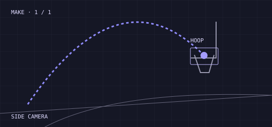

# Free Throw Coach

**Film your free throws from the side. Get a real coach's read on every shot.**

Built for the Meta Global AI Developer Hackathon (indie track) with **SAM 3.1** and **Muse Spark**.

- Demo video: _YOUTUBE LINK_
- Live demo: _HOSTED LINK_ (precomputed session, no setup)
- Code: this repo



## What it does

Upload or record a side-on clip of a free-throw session. The app:

1. **Tracks** the ball, the hoop and the shooter with **SAM 3.1** (Meta Model API, video segmentation).
2. **Measures** every shot in plain Python: arc peak, entry angle, where the ball crosses the rim (in inches, short or long), make/miss, and the shooter's routine (arm reach, lift tempo, time between shots).
3. **Coaches** with **Muse Spark**, which turns those numbers into one strength, one thing to work on and one drill. It only sees measured data, so it can't invent a flaw.
4. **Shows** an annotated replay with a dashed *ideal arc* (about 45° entry) beside your real path, a rim-crossing plot, a shot table and a PDF report.
5. **Answers questions** ("Why did I miss #26?") through an *Ask your coach* box, again grounded only in the session data. It says "I can't see that from a side camera" for things we don't measure, like elbow or wrist.

```
video ─► SAM 3.1 ─► ball / hoop / shooter boxes ─► shot metrics (Python) ─► Muse Spark coach
              │                                          │                        │
              └── hoop tracked every frame ──────────────┘                        ▼
                  (handles a moving camera)                       annotated video · report · PDF · Q&A
```

## How accurate is it? (honestly)

Make/miss calls checked against a hand-written log of every shot:

| Clip | Shots | Correct | Notes |
|---|---|---|---|
| Coach clip 1 | 27 | 26 / 27 | Used while building the system |
| Coach clip 2 (camera moves) | 32 | 29 / 32 | 20 → 27 → 29 as we added per-frame hoop tracking and a rim-out check. **Both fixes were designed after seeing this clip fail, so it is not a clean held-out test.** |
| Behind-the-shooter clip | 8 | 7-for-8 total matched the hand count | Unseen, wrong angle on purpose. The count matched; we did not check each shot individually. Treat it as a stress test, not an accuracy figure. |

What we know it gets wrong:

- **Left/right misses.** A side camera can't see them, so they read as makes. This is most of the remaining errors.
- **Borderline shots.** One make crossed 5.6 in off centre, just past our 5.5 in limit.
- **Arc fits.** Some shots have no usable entry angle or peak (the fit fails), so the coach says so instead of guessing.
- **Wrong angle.** From behind the shooter, arc and rim-offset numbers aren't trustworthy. The app detects implausible routine numbers, hides them and shows a warning. Make/miss counts are usually still right.

The accuracy numbers are also shown in the app (Accuracy section), generated by `build_accuracy.py`.

## Design choices worth knowing

- **Pixels to inches** use the hoop box width as a ruler (a rim is 18 in), so no camera calibration.
- **A moving camera** is handled by tracking the hoop every frame and measuring the ball relative to it.
- **Shooter metrics** are relative to the shooter's own body height, because the shooter is at a different camera depth than the hoop.
- **SAM on the full video is slow for people**, so the shooter and hoop are tracked in short, downscaled windows around each shot, in parallel.
- **Muse Spark gets numbers, not video.** Every claim in a verdict traces back to a measured value.

## Run it

```bash
git clone https://github.com/anishchugh05/Free-Throw-Coach
cd Free-Throw-Coach
python -m venv .venv && source .venv/bin/activate
pip install -r requirements.txt      # includes meta-sam-parser (Meta's SAM response parser)
cp .env.example .env                 # add your MODEL_API_KEY
python -m uvicorn app:app --port 8000
```

Open http://localhost:8000, go to **Studio**, and upload or record a clip.
Use `--host 0.0.0.0` to try it from a phone on the same Wi-Fi (in-browser recording needs HTTPS; uploading a phone video works over plain HTTP).
`ffmpeg` must be on your PATH.

**Filming tips:** fixed side-on camera, hoop and the full arc in frame, 1080p is plenty, about 30–60 seconds per set.

## Repo map

| File | Role |
|---|---|
| `app.py`, `process.py` | FastAPI server and the job pipeline |
| `sam_client.py`, `sam_run.py`, `sam_windows.py` | SAM 3.1 calls: full video, and windowed tracking for the shooter and hoop |
| `pipeline.py`, `shotmetrics.py` | Shot detection and the physics: arc fit, rim crossing, make/miss |
| `shooter.py` | Routine metrics and the plausibility gate |
| `coach.py` | Muse Spark coaching and Q&A prompts |
| `render.py` | Annotated video, including the ideal-arc overlay |
| `build_accuracy.py`, `score.py` | Scoring against hand logs (`shot_log.txt`, `coach2_log.txt`) |
| `static/` | Frontend (vanilla HTML/CSS/JS) |

## Limits and what's next

- Side-on only for arc and offset numbers. Left/right accuracy would need a second camera.
- No body-pose model yet, so no elbow or wrist feedback. We chose to stay on Meta models rather than add a non-Meta pose model.
- Accuracy was checked on a few clips by one person. A bigger, independent set is the obvious next step.

## Credits

Built by Anish Chugh (UMass Amherst). Uses Meta SAM 3.1 and Muse Spark through the Meta Model API.
